<div align="center">


# AIROX Connect

**Your AIRUX PC and AIRA, in your pocket.**

The Android app for [AIRUX](https://github.com/Absurd28/AIRUX_OS): talk to **AIRA** (*Adaptive Intelligent
Research Assistant*), see and manage what your PC is running, move files both ways, and turn your phone
or tablet into a touchpad or a **second screen**, all over your own network.

<a href="https://github.com/Absurd28/AIROX_Connect/actions/workflows/ci.yml"></a>


<br/><br/>

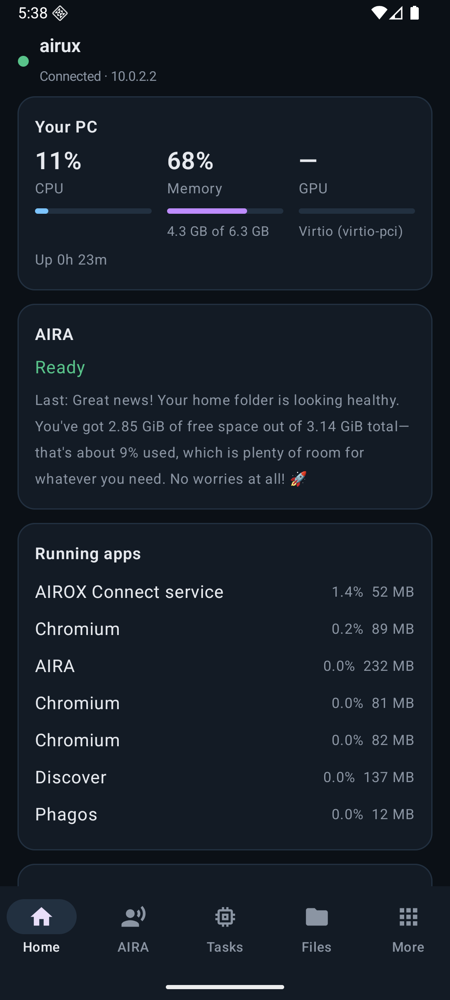&nbsp;&nbsp;
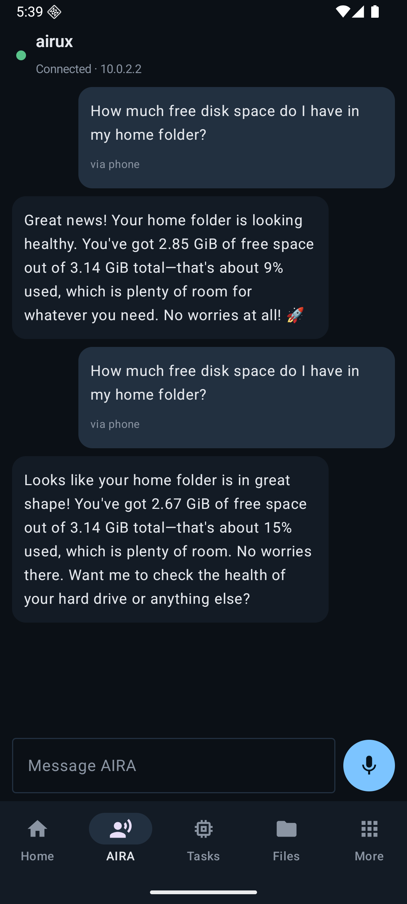&nbsp;&nbsp;
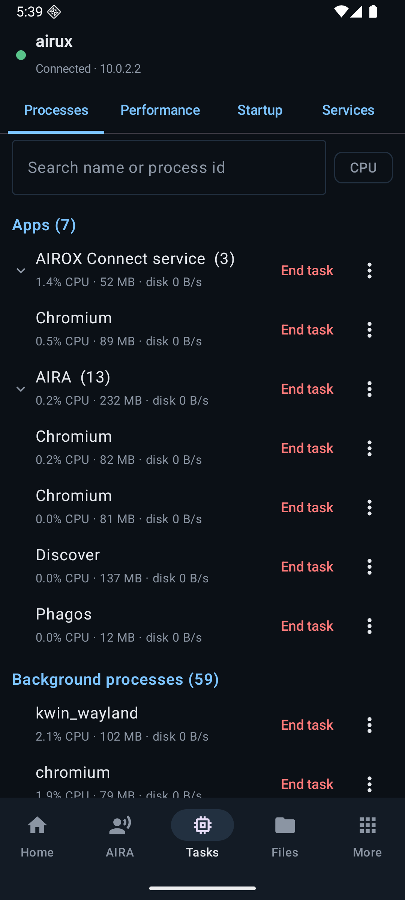

</div>

---

## ✨ What it does

| | |
| --- | --- |
| 🎙️ **Talk to AIRA** | Type, or hold the mic and speak. Your voice is transcribed on the PC (whisper.cpp) and AIRA answers on the phone **in her own voice**. Every answer keeps her *verified* / *unverified* / *not sure* tags. |
| 🏠 **See what's going on** | Live CPU, memory and GPU, the apps that are open, what AIRA is doing, recent actions and the Phagos antivirus status. |
| 📊 **Task Manager** | Processes grouped like Windows (apps, background, system), live performance graphs, startup apps, services and users. End a program, change its priority, start or stop a service. |
| 📁 **Files both ways** | Browse your PC's home folder and download anything; send photos, videos and documents to the PC, from the app or Android's **Share** menu. Resumable and checked with SHA-256. |
| 📋 **Clipboard and links** | Copy between phone and PC; open a link from your phone in NEOX on the PC. |
| 🖱️ **Touchpad and media** | Use the phone as mouse and keyboard; play/pause, next track, volume. |
| 🖥️ **Second screen** | Your phone or tablet becomes **another monitor** of the PC: drag windows onto it and use them by touch. Or mirror a screen. The delay from the PC to your screen is shown live. |
| 🔌 **Power** | Lock, sleep, restart or shut down the PC, and wake it again with Wake-on-LAN. |
| 🔔 **Alerts and approvals** | AIRA's reminders, finished jobs and Phagos warnings arrive as notifications. Approve or deny AIRA's risky actions from the phone. Lost your phone? Ask AIRA to ring it. |

## 📸 Screenshots

Taken from the app running against AIRUX in a virtual machine. AIRA's answer comes from the real local
model, and the PC is the real AIRUX ISO.

<div align="center">

| Pair with your PC | Home | Talk to AIRA |
| :---: | :---: | :---: |
| 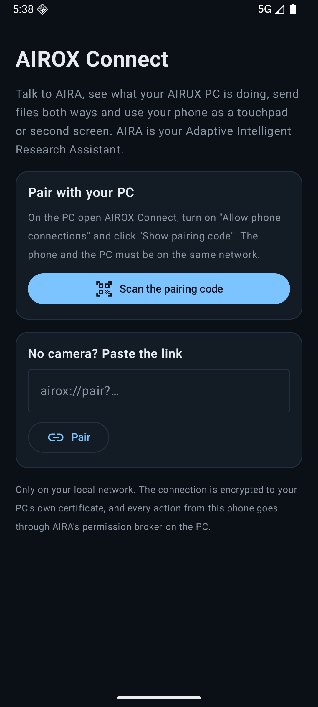 |  |  |
| **Task Manager** | **Live performance** | **Risky actions ask first** |
|  | 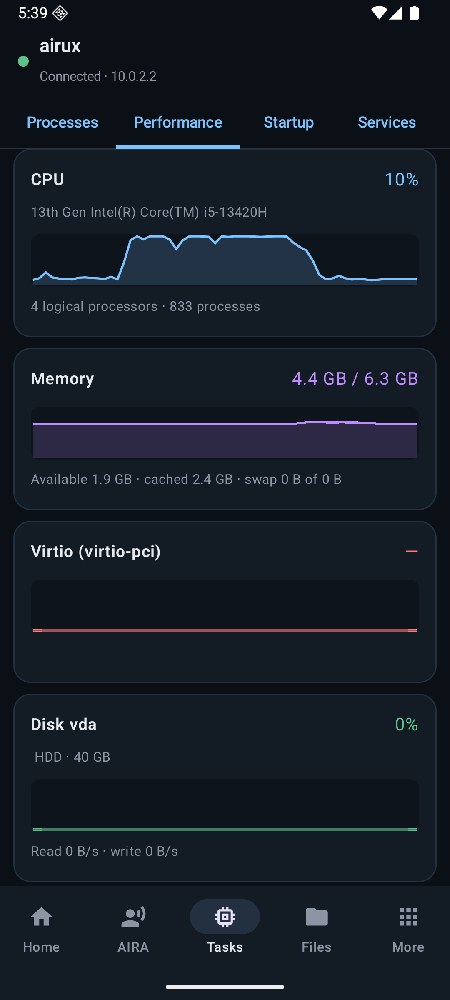 | 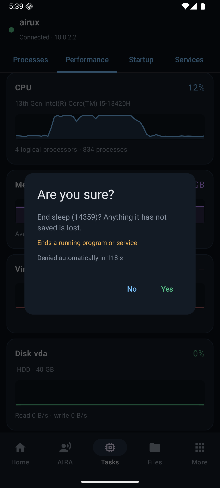 |
| **Your PC's files** | **Touchpad, keyboard and media** | **Glance at the PC** |
| 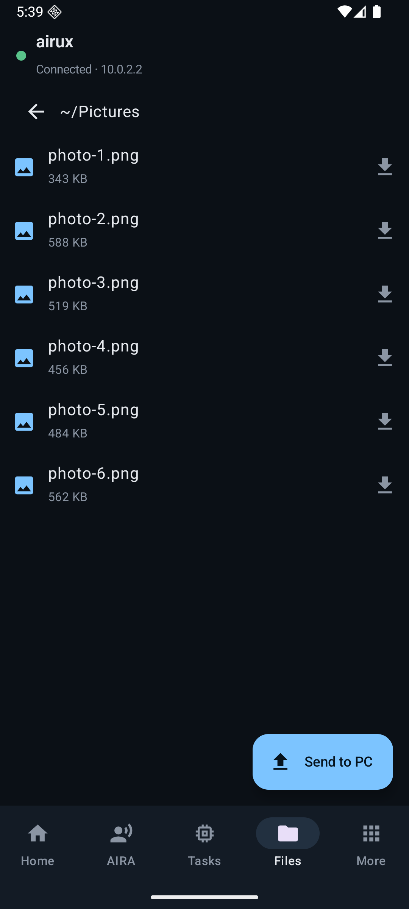 | 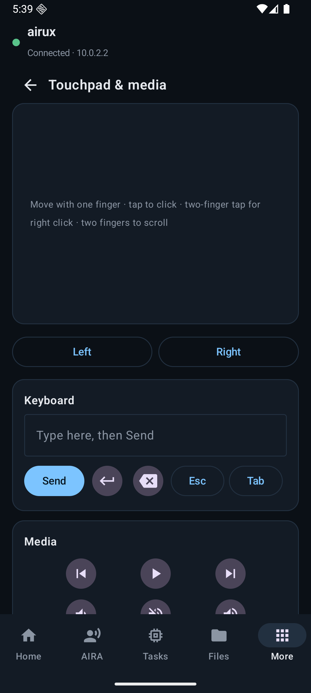 | 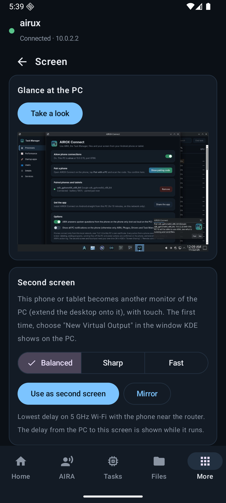 |

**Second screen: the PC's Task Manager, dragged onto the phone. The delay is measured live (top left; 87 ms here, in a VM without a GPU encoder)**

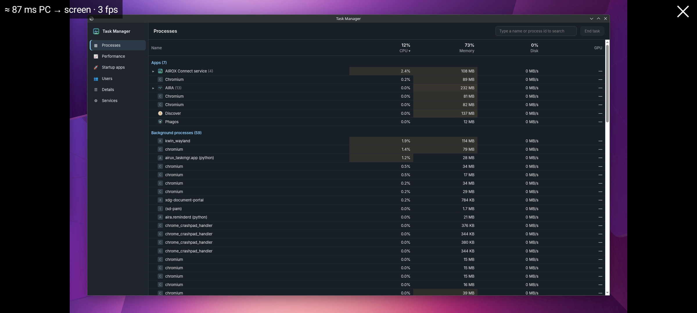

**On the PC: the AIROX Connect window shows the pairing code, and you allow the phone there**

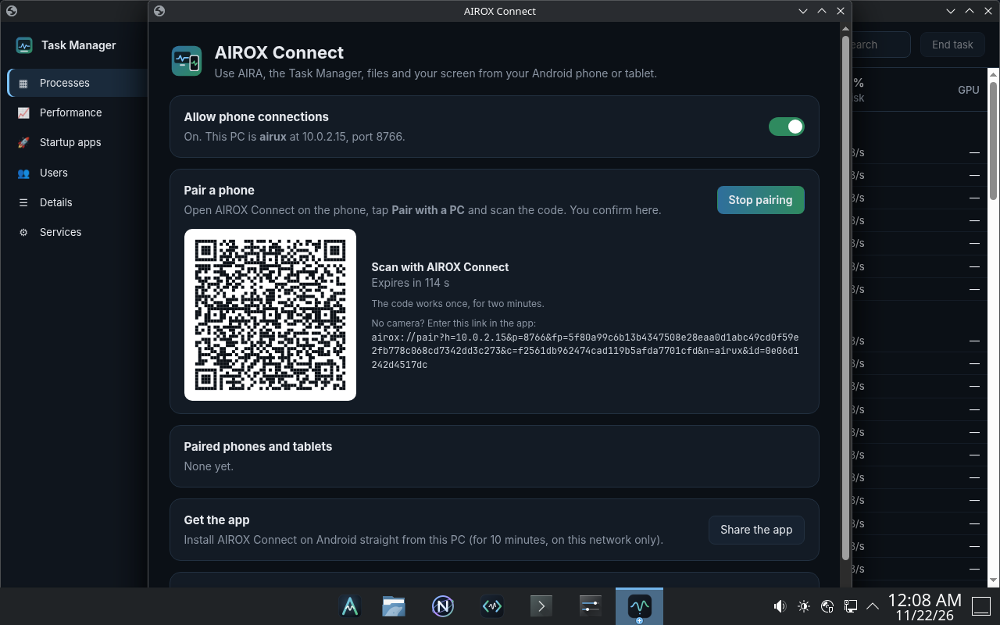&nbsp;
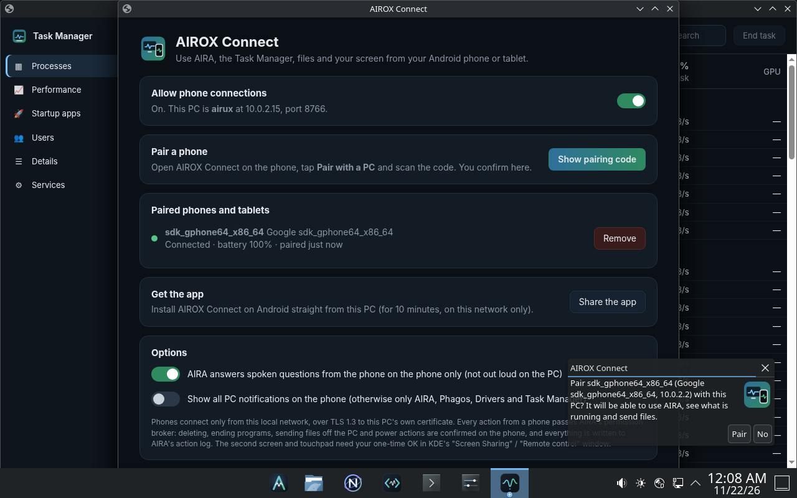

</div>

## 🔒 Safe by design

- **Your network only.** The PC accepts phones only from local addresses, and only after you switch on
  *Allow phone connections* on the PC.
- **Paired, not guessed.** The QR code works once and for two minutes, and you click **Allow** on the PC.
- **Encrypted to *your* PC.** TLS 1.3 to the PC's own certificate, whose fingerprint comes in the QR
  code: no other computer can pose as it. The phone's token is encrypted with the Android Keystore,
  and the PC stores only a hash of it.
- **AIRA's rules apply.** Every action goes through AIRA's permission broker on the PC. Ending
  programs, sending files off the PC and power actions ask you first. Deleting, administrator
  actions and installs also need your phone's **screen lock or fingerprint**. Everything is written
  to AIRA's action log.
- **No cloud.** No account, no tracking, no server in between. Nothing leaves your network.

## 📲 Install and pair

Android 10 or newer, and a PC running AIRUX.

1. On the PC, open **AIROX Connect** from the Start menu and turn on **Allow phone connections**.
2. Get the app: click **Share the app** and scan the code with the phone's camera, or copy
   `/usr/share/airox-connect/airox-connect.apk` from the PC. Open the APK and allow installing from
   that source. (Or build it yourself, below.)
3. In the app tap **Scan the pairing code**. On the PC click **Show pairing code**, then **Allow**.
4. The first time you use the second screen or the touchpad, KDE asks once on the PC: choose
   **New Virtual Output** ("Screen Sharing") and **Share** ("Remote control").

## ⚙️ How it works

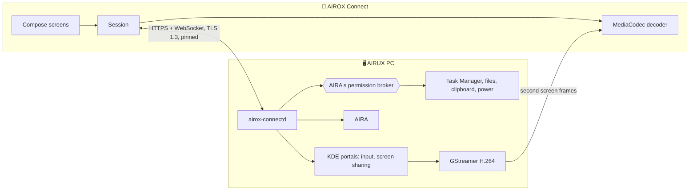

- **One connection, three channels:** HTTPS for requests, a WebSocket for AIRA's conversation,
  approvals, alerts and the touchpad, and another WebSocket for the second screen's H.264 video,
  decoded by the phone's hardware decoder in low-latency mode.
- **The second screen is a real monitor:** KDE's "New Virtual Output" gives the PC an extra display,
  and the app sends touches back as pointer events.
- **The protocol is documented** in [docs/PROTOCOL.md](docs/PROTOCOL.md), so an iOS app can follow.

## 🛠️ Build

You need the Android SDK (platform 36) and JDK 17 or newer (Android Studio's is fine).

```sh
./gradlew assembleDebug              # app/build/outputs/apk/debug/app-debug.apk
./gradlew assembleDebugAndroidTest   # the tests
```

## ✅ Tests

| Test | What it checks |
| --- | --- |
| `UnitTests.kt` | Pairing link parsing, the certificate pin, discovery replies, the Wake-on-LAN packet, the WAV format, H.264 key frames, transcript merging |
| `E2E.kt` | The whole app against a real AIRUX PC: pairing, refusals, AIRA by text and voice, ending a process (no / yes), files both ways, clipboard and links, touchpad and volume, glance, second screen, a reminder as a notification, AIRA's delete approved with the phone's PIN |
| `StrongConfirm.kt` | Administrator and delete approvals need the phone's screen lock |
| `Tour.kt` | The screenshots above |

The end-to-end tests run with AIRUX's `tests/connect_check.py`, which boots the AIRUX ISO in QEMU and
plays the person at the PC (it allows the pairing and answers KDE's windows) while checking every
result on the PC.

```sh
adb shell am instrument -w -e notClass org.airux.connect.E2E,org.airux.connect.Tour,org.airux.connect.StrongConfirm \
    org.airux.connect.test/androidx.test.runner.AndroidJUnitRunner
```

On every push and pull request, [CI](.github/workflows/ci.yml) builds the debug APK, runs lint and runs
`UnitTests.kt` on an Android 14 emulator.

## 🚀 Releasing

Releases are built and signed by [release.yml](.github/workflows/release.yml) when you push a `v*` tag.
The signing key is yours: it is never in this repository.

1. **Once, create the key** (keep the file and both passwords safe: every later version must be signed
   with the same key, or phones can't update):

   ```sh
   keytool -genkeypair -v -keystore airox-release.jks -alias airox -keyalg RSA -keysize 4096 -validity 10000
   ```

2. **Once, add four secrets** under the repo's **Settings → Secrets and variables → Actions**:

   | Secret | Value |
   | --- | --- |
   | `AIROX_KEYSTORE_B64` | the keystore as base64: `base64 -w0 airox-release.jks` (Linux) or `[Convert]::ToBase64String([IO.File]::ReadAllBytes("airox-release.jks"))` (PowerShell) |
   | `AIROX_KEYSTORE_PASSWORD` | the keystore password |
   | `AIROX_KEY_ALIAS` | `airox` |
   | `AIROX_KEY_PASSWORD` | the key password |

3. **Each release:** raise `versionCode` and set `versionName` in `app/build.gradle.kts`, commit, then

   ```sh
   git tag vX.Y.Z && git push origin vX.Y.Z
   ```

   The tag must be `v` + `versionName`. The workflow stops if a secret is missing (it never ships a
   debug-signed APK), verifies the signature, publishes `airox-connect-X.Y.Z.apk` and its `.sha256`, and
   prints the size and SHA-256 for the website's `site.json`.

To sign a release build locally, set `AIROX_KEYSTORE` (the file's path), `AIROX_KEYSTORE_PASSWORD`,
`AIROX_KEY_ALIAS` and `AIROX_KEY_PASSWORD` and run `./gradlew assembleRelease`. Without them the release
APK is unsigned.

> **Coming from 0.1.0?** That preview was signed with a debug key, so Android won't update it to a
> release-signed version. Uninstall it once, install the new APK and pair again. Later updates install
> over the top.

## 🗂️ Project layout

```text
app/src/main/java/org/airux/connect/
  data/       pairing link, the paired PC and its Keystore-encrypted token
  net/        certificate pinning, the session (REST, events, reconnect), discovery, Wake-on-LAN
  media/      push-to-talk recording (16 kHz WAV), AIRA's voice on the phone
  transfer/   resumable uploads and downloads with SHA-256 checks
  stream/     second screen: WebSocket -> MediaCodec, clock sync and delay
  service/    background connection, notifications, approvals, "ring my phone"
  ui/         pairing, Home, AIRA, Tasks, Files, More, second screen, share sheet
docs/         protocol, screenshots
```

## 🗺️ Roadmap

- [x] Android: AIRA, Task Manager, files, clipboard, touchpad, second screen, power, alerts (same network)
- [ ] Reach your PC from other networks (a Tor onion service: no account, no port forwarding)
- [ ] iOS

## 📄 License

MIT. It uses AndroidX, Jetpack Compose, Material 3, CameraX, Kotlin and kotlinx.coroutines, OkHttp
and Okio, and ZXing core, all Apache-2.0.

<div align="center"><sub>Part of <a href="https://github.com/Absurd28/AIRUX_OS">AIRUX</a> · made by <a href="https://github.com/Absurd28">Aryan Mitra</a></sub></div>
